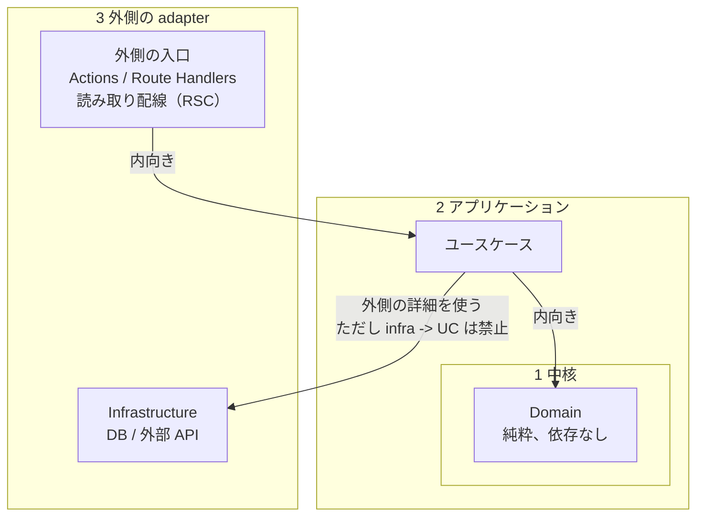

# ⚙️ Next.js / backend — 責務分離（サーバー側の差分）

> **対象: Next.js（App Router）のサーバー側処理。** Next.js でなければ適用外として扱い、破棄する。
>
> **共通規約は [common/coding.md](common-coding.instructions.md)**（整形はツールが決める。成功させるために型を弱めない。
> named export、barrel 禁止、パスエイリアス、秘密情報と `NEXT_PUBLIC_`）。
> テストの書き方は [testing.md](backend-testing.instructions.md)（共通の配線は [common/testing.md](common-testing.instructions.md)）。
> この文書は **それらに従った上で**、サーバー側ロジックの置き場所だけを定義する。共通側は再掲しない。
>
> **harness はディレクトリ名を固定しない。** 場所はプロジェクトの `CLAUDE.md` に記録する。
> **固定するのは役割分離そのもの。** `applyTo` に現れる `domain/` などは探索の手掛かりであり、必須のフォルダー名ではない。
>
> **コメントとユーザー向けの文言は日本語で書く。**

---

## 0. 目的の定義（混ざると何を失うか）

App Router では Server Components も Server Actions もサーバーで実行される。
そのため、UI のすぐ隣に DB アクセスと判断を書いても **動く**。

壊れるのは「動くこと」ではなく、次を同時に失うことである。

- ドメイン判断を単独で試せない（DB と `next/*` が足かせになる）
- 同じ判断が Action、page、Route Handler へコピーされる
- cache 無効化や redirect が業務ロジックに食い込み、差し替えられなくなる

**この文書の役割は、責務を 1 つの関数（肥大化した Action）へ混ぜる抜け道を塞ぐことである。**

---

## 1. 4 つの役割。場所は問わない

| 役割 | 責務 | 含めてはいけないもの |
| --- | --- | --- |
| **Domain** | 業務規則、判断、計算 | DB / HTTP / 時計 / 乱数などの副作用。`next/*` |
| **Infrastructure** | 副作用: DB アクセス、外部 API、メール送信 | 複雑な業務判断・分岐（ドメイン知識）|
| **Use case** | シナリオの orchestration（取得 → 判断 → 保存の組み立て）| `revalidatePath` / `redirect` / `cookies` / `headers` など Next 固有 API |
| **外側の入口** | 信頼できない入力の検証、ユースケース呼び出し、Next/HTTP 固有 I/O | DB 操作やドメイン判断の本体 |

**外側の入口**には 2 つの実装形態がある（どちらも玉ねぎの外周であり、役割名は同じ「入口」）。

| 実装形態 | 使う場面 | 成功／失敗を呼び出し側へ伝える方法（詳細は §6）|
| --- | --- | --- |
| **ミューテーション・コントローラー — Server Actions** | 同一アプリ内からサーバー側の正本を変更する | **呼び出し側向け Result**。生の例外 stack を公開しない |
| **ミューテーション・コントローラー — Route Handlers** | 外部の利用者向け HTTP | **HTTP status + body**（同じ Result 形状を JSON として返してもよい）|
| **読み取り配線**（`page.tsx` / `layout.tsx` の RSC）| 初回表示などの読み取り | **`notFound()` / エラー UI / view props への写像**。Client 向け Result 型は必須ではない |

**ディレクトリ例**（拘束しない）:

`domain/` · `infrastructure/` · `use-cases/` · `app/actions/`（または Route Handlers）· `app/**/page.tsx`（読み取り配線）

**上記の役割を 1 つの関数やモジュールに混ぜない。**

### 1.1 実装の担当（誰が何を書くか）

| 成果物 | 実装者 |
| --- | --- |
| **domain / use cases / infrastructure の本体** | **backend-logic** |
| Server Actions / Route Handlers の **本体**（検証、ユースケース呼び出し、`revalidatePath` など）| **backend-logic** |
| `page` / `layout` の **読み取り配線**（params 検証、**既存**ユースケース呼び出し、view への props 受け渡し）| **frontend-logic** |
| 表示用の外観 | **frontend-ui** |
| `middleware.ts`（薄い境界のみ。[common/coding.md](common-coding.instructions.md) §4）| **backend-logic**（分ける場合はプロジェクトの `CLAUDE.md` に宣言する）|

frontend はユースケースと Actions を **呼び**、**props で渡す**だけであり、本体を作ったり膨らませたりしない。
読み取りに必要なユースケースがまだなければ **backend-logic 側で先に用意する**（FE が infra の直接呼び出しやユースケース作成へ逃げないようにする）。
backend は page の JSX を作らない。

---

## 2. 依存（玉ねぎ: 依存は内向きだけ）

レイヤーは玉ねぎのように同心円状である。**ソース参照（import）は常に内向きにする。**

```text
┌──────────────────────────────────────────────────────────────┐
│ ③ 外側の adapter（フレームワークと I/O が見える）            │
│                                                              │
│   外側の入口                        Infrastructure           │
│   · ミューテーション・コントローラー DB / 外部 API            │
│     （Actions / Route Handlers）                             │
│   · 読み取り配線（RSC page/layout）                          │
│        │                              ▲                      │
│        │ 呼ぶ                         │ 詳細を使う           │
│        ▼                              │                      │
│   ┌───────────────────────────────────┴────────────────────┐ │
│   │ ② アプリケーション — ユースケース                     │ │
│   │    シナリオを組み立てる（読取 → 判断 → 書込）           │ │
│   │                      │                                 │ │
│   │                      ▼ 判断を求める                    │ │
│   │         ┌────────────────────────────┐                 │ │
│   │         │ ① 中核 — domain            │                 │ │
│   │         │ 純粋な業務規則、計算       │                 │ │
│   │         │                            │                 │ │
│   │         │ （外側を何も知らない）     │                 │ │
│   │         └────────────────────────────┘                 │ │
│   └────────────────────────────────────────────────────────┘ │
└──────────────────────────────────────────────────────────────┘
```



| 輪 | レイヤー | 許される参照 | 禁止 |
| --- | --- | --- | --- |
| ① 中核 | **Domain** | なし（純粋な処理のみ）| infrastructure、ユースケース、外側の入口、`next/*` |
| ② | **Use case** | domain（必須）。組み立てに infrastructure を使ってよい | 外側の入口、`revalidatePath` など Next API |
| ③ 外側 | **外側の入口** | ユースケース（+ 境界のスキーマ検証）| infrastructure や domain の本体を直接書くこと。入口間で業務を完結させない |
| ③ 外側 | **Infrastructure** | DB、HTTP client など | ユースケース、外側の入口、業務判断 |

要点:

- **外側の入口と infrastructure は同じ外周にいる。** 両者を直結して業務を完結しない（必ずユースケースを通す）
- **domain が中核**であり、何にも依存しない
- **ユースケースは中核を守りながら外側を使うレイヤー**である

実行時（更新）: ミューテーション・コントローラー → ユースケース →（infra で読取 → domain で判断 → infra で書込）→ 呼び出し側へ成功／失敗を伝える（Actions は Result、RH は status + body）/ 必要に応じて `revalidatePath` など。
実行時（読み取り）: 読み取り配線 → ユースケース → view に props を渡す（§3）。

---

## 3. 入口の選択

| 目的 | 外側の入口の実装形態 |
| --- | --- |
| **同一アプリ内の更新** | **Server Actions**（ミューテーション・コントローラー）を既定にする |
| **外部公開 HTTP** | **Route Handlers**（`route.ts`）|
| **読み取り**（一覧・詳細の初回表示）| **読み取り配線**（RSC）。UI の薄さは [frontend/coding.md](frontend-coding.instructions.md)。読み取り用 Server Actions を増やさない |

すべて外側の入口であり、**入口に infrastructure と domain を直接書かない**。

---

## 4. ユースケースの流れ

ユースケースが書いてよいのは、おおむね次の組み立てだけである。

1. infrastructure 経由で読む
2. domain で判断・計算する
3. 必要なら infrastructure 経由で書く

ユースケースは **シナリオ結果**（成功データまたは理由コード）を返す。
フィールド名はプロジェクト内で揃える。ミューテーション・コントローラーが **呼び出し側向けの形**へ写像する（§6: Actions は Result、RH は status + body）。

```ts
//  OK: オーケストレーションだけ（シナリオ結果の例。形はプロジェクトで統一）
export async function renameUser(input: { id: string; name: string }, deps: Deps) {
  const current = await deps.users.findById(input.id);
  if (current === null) return { ok: false as const, reason: "not_found" as const };
  const decided = decideDisplayName(current, input.name); // ドメイン（純粋）
  if (!decided.ok) return decided;
  await deps.users.save(decided.user);
  return { ok: true as const, user: decided.user };
}
```

```ts
//  NG: ユースケースが Next に依存する
import { revalidatePath } from "next/cache";
//  NG: ユースケースに SQL／業務の長い分岐が同居する
```

`revalidatePath` / `redirect` / cookie 操作は **ミューテーション・コントローラー**に置く。

---

## 5. 信頼境界での実行時検証（zod）

TypeScript の型は compile 時だけの約束である。
**外から来る値**は **外側の入口の境界で実行時スキーマ検証（zod など）**を行い、通過したものだけをユースケースへ渡す。

| 入口 | 検証するものの例 |
| --- | --- |
| ミューテーション・コントローラー | Server Action の引数、Route Handler の body / query |
| 読み取り配線 | `params` / `searchParams`（必要なもの）|

- **境界で 1 回検証すれば十分。** ユースケースの入口や domain で「もう一度 zod」は要求しない
- 業務の不変条件は domain の責務であり、スキーマ検証の代わりにはならない
- 既定ライブラリは zod。他のものを使うプロジェクトは `CLAUDE.md` に宣言する

```ts
//  ミューテーション・コントローラー（Server Action）側のイメージ
const parsed = CreateUserSchema.safeParse(raw);
if (!parsed.success) {
  return { success: false as const, error: "入力が不正です" };
}
const outcome = await createUser(parsed.data, deps);
if (!outcome.ok) {
  return { success: false as const, error: toUserMessage(outcome.reason) };
}
revalidatePath("/users");
return { success: true as const, data: outcome.user };
```

読み取り配線の検証例は [frontend/coding.md](frontend-coding.instructions.md) §2 にある。

---

## 6. 失敗の伝え方（入口の実装形態で分ける）

### ミューテーション・コントローラー（Server Actions と Route Handlers）

どちらも同じ外側の入口の役割である。例外を放置して伝播させ、生の stack を呼び出し側へ公開しない。
**呼び出し側が成功と失敗を区別できること。** 伝え方はプロジェクト全体で **1 つの方式**に揃える。

| 実装形態 | 区別方法の例（固定しない）|
| --- | --- |
| Server Actions | 共通の呼び出し側向け Result（下の例）|
| Route Handlers | HTTP status + body（同じ Result 形状を JSON として返してもよい）|

```ts
//  Server Actions 向けの例（固定ではない）
type ActionResult<T> =
  | { success: true; data: T }
  | { success: false; error: string };
```

ユースケースのシナリオ結果（§4 の `ok` / `reason` など）と呼び出し側向けの形は **異なってよい**。
ミューテーション・コントローラーが境界で相互に写像する。demo と実装の間でフィールド名を混在させない。

### 読み取り配線（RSC）

Client に返す ActionResult 型は必須ではない。代わりに次のいずれかで表す。

- 不正な `params` → `notFound()` などの到達可能な UI
- 取得失敗 → `error.tsx` に委ねるか、view props で error / empty を渡す（[frontend/components.md](frontend-components.instructions.md)）

---

## ✅ 返却前チェックリスト

- [ ] 依存の矢印が逆流していないか？
- [ ] domain が副作用や `next/*` を持っていないか？
- [ ] infrastructure に業務分岐が沈んでいないか？
- [ ] ユースケースが `revalidatePath` / `redirect` / `cookies` などを import していないか？
- [ ] 外側の入口以外から infrastructure を直接呼んでいないか？
- [ ] frontend 側で Actions / Route Handlers の本体を膨らませていないか（§1.1）？
- [ ] 更新の主な入口は Server Actions（外部 HTTP は Route Handlers）か？
- [ ] 外から来た値をユースケースへ渡す前に境界でスキーマ検証しているか？
- [ ] 更新時、呼び出し側が成功と失敗を区別できるか（Actions = Result、RH = status + body。読み取りは §6 の RSC 処理に従う）？
